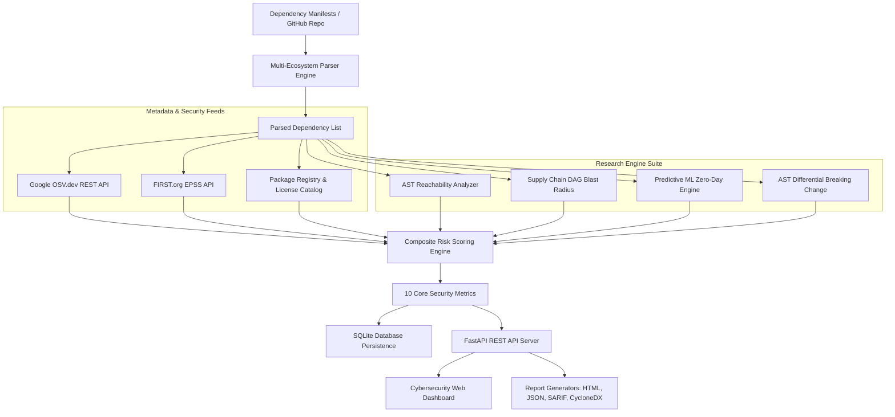

# 🛡️ Software Dependency Security Analyzer

[](https://www.python.org/)
[](https://osv.dev/)
[](https://fastapi.tiangolo.com/)
[](https://cyclonedx.org/)
[](#-academic-research--algorithmic-innovations)
[](LICENSE)

An enterprise-grade **Software Dependency Security Analyzer** with a modern cybersecurity dark interface, REST API, CLI, and database persistence. It automates dependency vulnerability detection, license compliance analysis, supply chain DAG graphing, automated non-breaking remediation recommendations, and security posture comparison across scans.

---

## 🌟 Key Highlights & 10 Security Metrics

The dashboard features **10 core security metrics** computed entirely from actual scan data and live threat intelligence:

1. **Overall Security Risk Score (0–100)**: Composite risk rating reflecting CVSS severity, EPSS exploitability velocity, AST call-graph reachability, and malware indicators.
2. **Total Dependencies Scanned**: Complete Software Bill of Materials (SBOM) count across direct and transitive dependencies.
3. **Vulnerable Dependencies**: Number of packages affected by at least one confirmed vulnerability.
4. **Critical Vulnerabilities**: Count of CVSS 9.0–10.0 or RCE/critical-impact CVEs.
5. **High-Severity Vulnerabilities**: Count of CVSS 7.0–8.9 security flaws.
6. **Outdated Dependencies**: Packages with newer upstream versions available in PyPI, npm, or Maven registries.
7. **License Compliance Issues**: Detected restrictive copyleft licenses (e.g., GPL, AGPL, SSPL) or unverified licenses that threaten intellectual property in commercial projects.
8. **Transitive Dependencies**: Indirect sub-dependencies pulled into the build hierarchy.
9. **Security Issues Fixed / Fixable**: Count of vulnerabilities with verified non-vulnerable upgrade versions available.
10. **Dependency Health Score (0–100)**: Holistic project dependency hygiene score (100 is pristine, reduced by vulnerabilities, outdated packages, unmaintained libraries, and license risks).

---

## 🧭 Functional Modules & Dashboard Capabilities

The application provides a responsive sidebar with 10 functional modules:

### 1. 📊 Security Overview Dashboard
- Interactive **10 KPI metric cards** with severity indicators and trend badges.
- **Vulnerability Severity Breakdown Chart** (Doughnut chart by Critical, High, Medium, Low).
- **Security Risk Score Trend Chart** (Historical timeline across previous scans).
- **Research Innovations Panel** displaying false-positives eliminated, average blast radius, predicted zero-days, and breaking changes prevented.

### 2. 🔍 Dependency Scanner
- **Option 1: Upload Dependency Manifest**: Drag-and-drop or browse files (`requirements.txt`, `package.json`, `pom.xml`, `pyproject.toml`). Real-time validation and progress tracking.
- **Option 2: Scan Remote GitHub Repository**: Scan public GitHub repositories directly by entering URL and target branch (`main`, `master`, or custom). Automatically crawls tree manifests.
- Customizable Quality Gate controls (Risk Score threshold slider, fail-on-critical toggle).

### 3. 📦 Dependency Inventory (SBOM)
- Tabular inventory of all detected direct and transitive dependencies.
- Displays package name, installed version, latest registry version, ecosystem, dependency depth, license, and security status.
- Real-time search, ecosystem filtering (PyPI, npm, Maven, Go, crates.io), and status filters (Vulnerable, Outdated, Direct, Transitive, License Risk).
- Column sorting by package name, version, and ecosystem.

### 4. 🚨 Vulnerability Management & CVE Tracker
- Comprehensive vulnerability records queried from Google OSV.dev and NVD.
- Displays CVE ID, CVSS v3 score, EPSS exploitation probability, affected package, fixed version, and AST call-graph reachability status.
- Filter by severity (All, Critical, High, Medium, Low) and keyword search.
- **Detail Inspection Modal**: Full vulnerability summary, impact analysis, remediation advice, and direct links to official advisories.

### 5. ⚖️ License Compliance Analyzer
- Automated license classification:
  - **Permissive**: MIT, Apache-2.0, BSD, ISC (Safe for commercial use).
  - **Weak Copyleft**: LGPL, MPL-2.0, EPL-2.0 (Component-level compliance).
  - **Strong Copyleft (Restrictive)**: GPL-2.0, GPL-3.0, AGPL-3.0, SSPL (Reciprocal license risk).
  - **Unknown / Missing**: Flagged for manual review.
- Restrictive license alert banner when GPL/AGPL dependencies are detected.
- Interactive License Distribution Doughnut chart and full package license table.

### 6. 🕸️ Interactive Dependency Supply Chain Graph
- HTML5 Canvas Directed Acyclic Graph (DAG) visualizing direct and transitive dependency trees.
- Color-coded node indicators: Direct (cyan/blue), Transitive (gray/slate), Vulnerable (pulsing red/amber border).
- Interactive controls: **Zoom In**, **Zoom Out**, **Pan Canvas**, **Reset View**, **Highlight Vulnerable Only**, and **Draggable Nodes**.
- **Package Inspector Side Drawer**: Click any node to inspect version, license, blast radius, and vulnerability counts.

### 7. 🛠️ Automated Remediation Center
- Automated, non-breaking upgrade recommendations.
- Compares installed version vs recommended target version, displaying which CVEs are resolved.
- SemVer breaking change risk index ($0.0$ to $1.0$).
- One-click copyable upgrade commands (`pip install --upgrade ...` or `npm install ...`).
- **Strict Safety Notice**: Recommended guidance only; never automatically modifies dependency files without explicit developer authorization.

### 8. 📜 Scan History & Security Posture Comparison
- Persistent scan logs stored in SQLite database (`devsecops.db`).
- Review past scan timestamps, targets, risk scores, and quality gate outcomes.
- One-click loading of past scans.
- **Scan Comparison Feature**:
  - Select two historical scans (Baseline Scan A vs Comparison Scan B).
  - Calculates Risk Score Delta and Health Score Delta.
  - Highlights **Newly Introduced Vulnerabilities** (regressions).
  - Highlights **Resolved Vulnerabilities** (fixed issues).
  - Tracks added, removed, and upgraded packages.

### 9. 📑 Security Report Generator
Downloadable executive and machine-readable reports:
- **HTML Report**: Self-contained executive report with dark styling, KPI cards, charts, and remediation guidance.
- **JSON Report**: Machine-readable scan object containing all 10 metrics, graph nodes, and inventory.
- **SARIF Report**: OASIS SARIF v2.1.0 standard report for native GitHub Code Scanning integration.
- **CycloneDX SBOM**: CycloneDX v1.4 JSON SBOM with purls, licenses, and component hashes.

### 10. ⚙️ Settings & System Information
- Quality Gate threshold configuration.
- Real-time threat feed status indicators (Google OSV.dev, FIRST.org EPSS, PyPI / npm registries).

---

## 🔬 Academic Research & Algorithmic Innovations

The scanner integrates 4 specialized program analysis algorithmic suites:

1. **🧬 AST Call-Graph Reachability Engine** (`analyzer/research/reachability.py`): Parses application source code AST to verify if vulnerable third-party symbols are actually imported or invoked. Disregards unreachable false-positive alerts.
2. **🕸️ Graph-Theoretic Blast-Radius Engine** (`analyzer/research/graph_engine.py`): Models dependency hierarchy DAGs, computing Degree Centrality and cascading supply-chain blast-radius metrics.
3. **🔮 Predictive ML Zero-Day & Maintainer Health Engine** (`analyzer/research/ml_predictor.py`): Analyzes version staleness velocity, maintainer activity, and EPSS velocity to identify potential zero-day exposure.
4. **🤖 AST Differential Breaking-Change Predictor** (`analyzer/research/ast_diff.py`): Evaluates semantic version shifts between current and patched versions to quantify breaking change risks.

---

## 🏗️ System Architecture



---

## 🚀 Installation & Execution

### 1. Prerequisites
- Python 3.10+ (tested on Python 3.11, 3.12, 3.13)
- Git (optional, for remote repository scanning)

### 2. Setup Virtual Environment

```bash
# Clone or navigate to the repository
cd "c:\Users\sagar\OneDrive\Desktop\Intern Project"

# Create and activate virtual environment
python -m venv venv

# Windows PowerShell:
.\venv\Scripts\Activate.ps1
# Windows Command Prompt:
.\venv\Scripts\activate.bat
# Linux/macOS:
source venv/bin/activate

# Install dependencies
pip install -r requirements.txt pytest httpx
```

### 3. Launch Web Dashboard & REST Server

```bash
python -m uvicorn server:app --host 127.0.0.1 --port 8000 --reload
```

Open your browser and navigate to:
👉 **`http://127.0.0.1:8000`**

### 4. CLI Scanning Command

```bash
# Scan a local file
python main.py scan samples/sample_requirements.txt --html report.html --json report.json --sarif report.sarif

# Scan with strict risk threshold
python main.py scan samples/sample_package.json --threshold 60.0

# Scan a remote GitHub repository
python main.py scan-github https://github.com/pallets/flask --branch main --html flask_report.html
```

---

## 🧪 Automated Testing

Run the automated test suite with pytest:

```bash
pytest
```

Output:
```text
============================= test session starts =============================
tests/test_metadata.py ...                                               [ 13%]
tests/test_modules.py ...                                                [ 26%]
tests/test_parsers.py ......                                             [ 52%]
tests/test_research.py ....                                              [ 69%]
tests/test_scoring.py ..                                                 [ 78%]
tests/test_server.py .....                                               [100%]
======================= 23 passed, 1 warning in 34.36s ========================
```

---

## 📡 REST API Reference

| Method | Endpoint | Description |
|---|---|---|
| `GET` | `/` | Serves the interactive cybersecurity dashboard |
| `GET` | `/api/health` | System and threat feed status |
| `POST` | `/api/scan/file` | Upload manifest file (`requirements.txt`, `package.json`, `pom.xml`, `pyproject.toml`) |
| `POST` | `/api/scan/github` | Scan public/private GitHub repository manifests |
| `GET` | `/api/scans` | List previous scan records |
| `GET` | `/api/scans/{scan_id}` | Retrieve complete scan report by ID |
| `GET` | `/api/scans/compare?scan_a={id}&scan_b={id}` | Compare two scans: score deltas, newly introduced & resolved CVEs |
| `GET` | `/api/scans/{scan_id}/export/{format}` | Export report as `html`, `json`, `sarif`, or `cyclonedx` |
| `GET` | `/api/analytics` | Aggregate statistics and historical trend data |
| `POST` | `/api/scans/{scan_id}/push-dependency-track` | Push CycloneDX SBOM to OWASP Dependency-Track |

---

## 📁 Project Directory Structure

```text
Software-Dependency-Security-Analyzer/
├── main.py                     # CLI Entry point
├── server.py                   # FastAPI Application Server & REST API
├── db.py                       # SQLite Database models, migrations & scan comparison
├── Dockerfile                  # Container build instructions
├── docker-compose.yml          # Container orchestration configuration
├── Jenkinsfile                 # CI/CD deployment pipeline for Azure VM
├── requirements.txt            # Python dependencies
├── README.md                   # Comprehensive documentation
├── samples/                    # Sample manifests for all supported formats
│   ├── sample_requirements.txt # Python requirements
│   ├── sample_pyproject.toml   # Poetry / pyproject.toml
│   ├── sample_package.json     # Node.js manifest
│   └── sample_pom.xml          # Java Maven POM
├── analyzer/
│   ├── models.py               # Data models with 10 metrics & ResearchMetrics
│   ├── metadata.py             # License detection, outdated checking & registry query
│   ├── github.py               # Remote GitHub manifest fetcher
│   ├── parsers/                # Parsers: Python, Node, Java, Go, Rust
│   ├── scanners/               # OSV Scanner & ScanManager with transitive resolution
│   ├── research/               # Academic Research Engines (AST, DAG, ML, Diff)
│   ├── scoring/                # RiskEngine computing the 10 Core Security Metrics
│   └── reporters/              # HTML, JSON, SARIF, CycloneDX & Terminal Reporters
├── web/                        # Modern Dark Cybersecurity UI
│   ├── index.html              # 10-module dashboard layout & modals
│   ├── dashboard.css           # Modern dark design & responsive layout
│   └── app.js                  # Frontend controllers, Chart.js & canvas graph
└── tests/                      # Automated test suite (23 tests passing)
```

---

## 🛡️ License

Licensed under the [MIT License](LICENSE).
